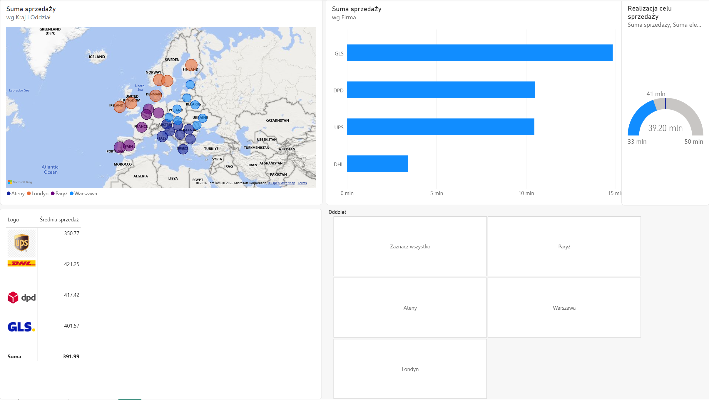
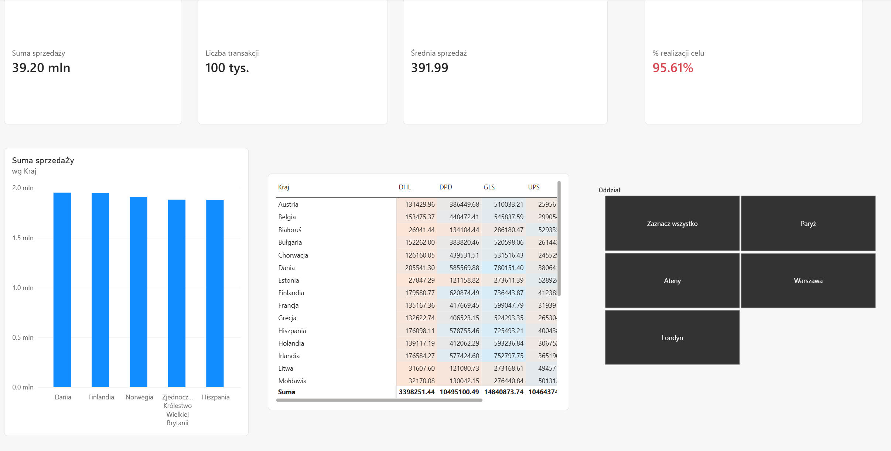

# Courier Sales KPI Dashboard

Interactive Power BI report analysing sales of four courier companies (DHL, DPD, GLS, UPS) across European countries and four regional branches (Athens, London, Paris, Warsaw), with tracking of sales targets.



## Business questions

- What are total sales and how close are we to the annual sales target?
- Which courier company generates the highest revenue, and which has the highest average transaction value?
- Which countries are the top 5 markets?
- Which courier dominates in each country?
- How does target achievement change per branch?

## Data

Excel workbook with 5 tables:

| Table | Description |
|---|---|
| Purchases (fact table) | ~100,000 transactions: value, country code, branch, courier |
| Courier companies | Courier name and logo (Base64 image) |
| Countries | Country code and name |
| Branches | Branch code and city |
| Targets | Minimum, target and maximum sales per branch |

## Data preparation (Power Query)

- Promoted headers and set correct data types (decimal values, whole-number codes, text fields)
- Validated all tables before loading

## Data model

Star schema with the Purchases table as the fact table:

- Courier companies 1 : * Purchases
- Countries 1 : * Purchases
- Branches 1 : * Purchases
- Targets 1 : 1 Branches (bidirectional filtering, so the branch slicer also updates the target on the gauge)

## DAX measures

```DAX
Total Sales      = SUM(Purchases[Value])
Average Sale     = AVERAGE(Purchases[Value])
Transactions     = COUNTROWS(Purchases)
Sales Target     = SUM(Targets[Target Value])
Target Achieved % = DIVIDE([Total Sales], [Sales Target])
```

## Report features

- Bubble map of sales by country and branch
- Matrix with courier logos (image URL data category)
- Gauge showing sales against minimum, target and maximum values
- KPI cards with conditional formatting (red below 100% of target, green from 100%)
- Top 5 countries chart (Top N filter, sorted descending)
- Country × courier matrix with background colour scale
- Tile slicer for branches, with edited interactions so KPI cards always show company-wide totals



## Key insights

- Total sales reached **39.20M** against a target of **41M**, i.e. **95.61%** of the target.
- **GLS** has the highest total sales, while **DHL** has the lowest total but the **highest average transaction value** (421.25 vs. 391.99 overall).
- The top 5 markets are **Denmark, Finland, Norway, the United Kingdom and Spain**, each close to 2M.
- **GLS dominates in Spain** (≈725K, ahead of DPD with ≈579K).

## Tools

Power BI Desktop · Power Query · DAX · data modelling

## Context

Built as part of a data analytics course (Power BI). The dataset was provided in the course materials. The report interface and data are in Polish.
